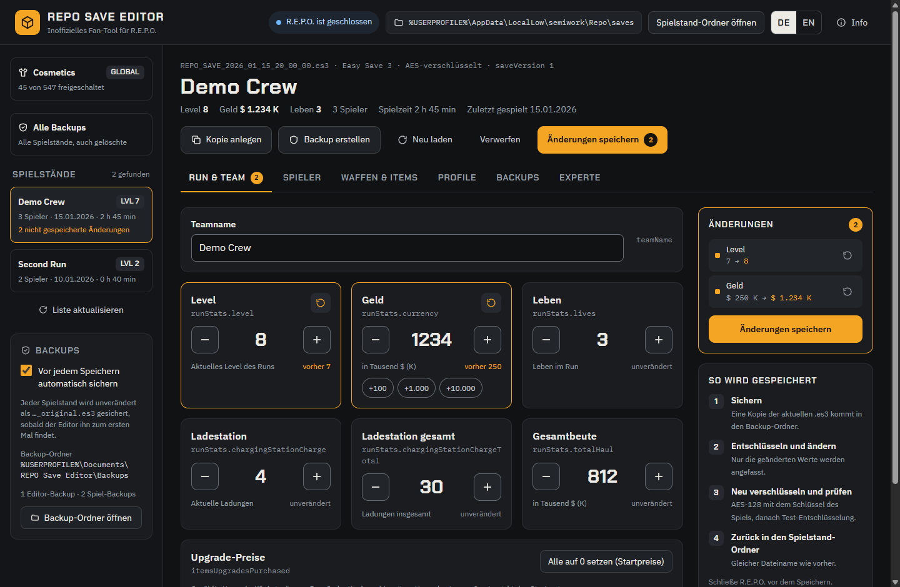
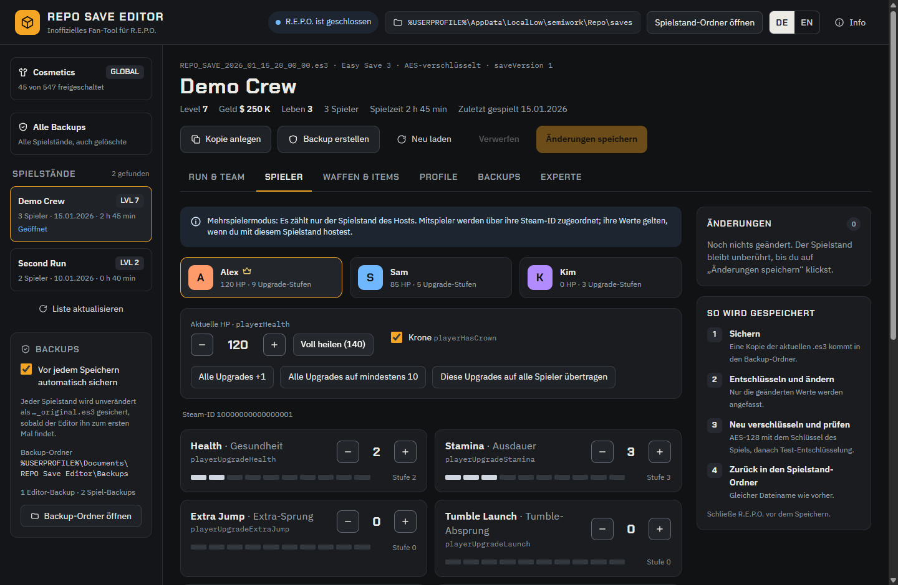
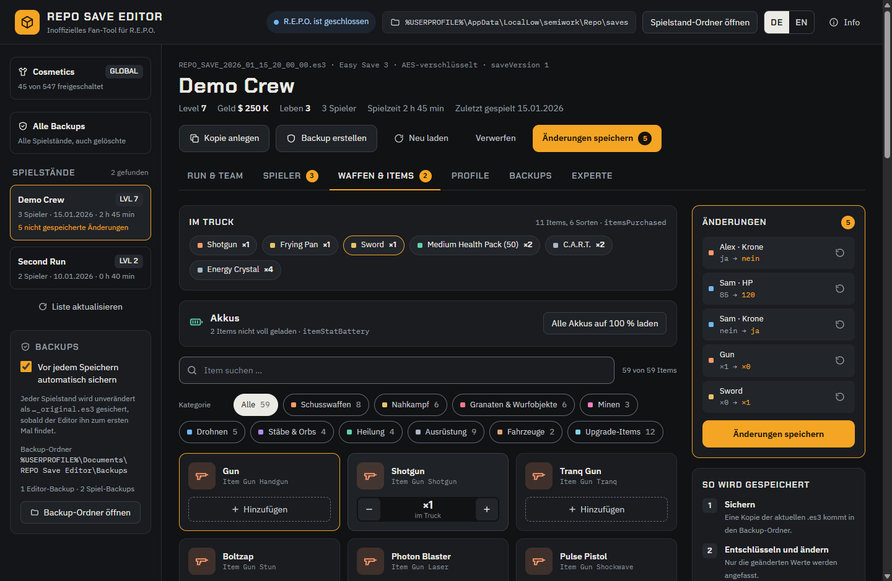
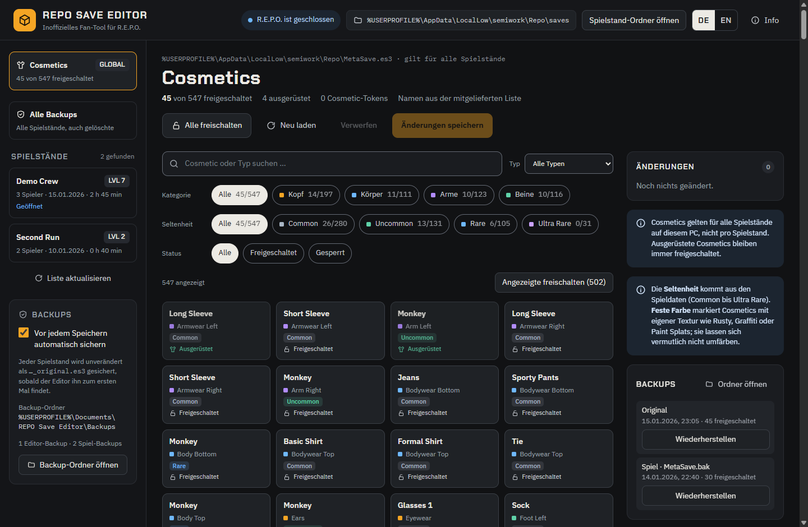
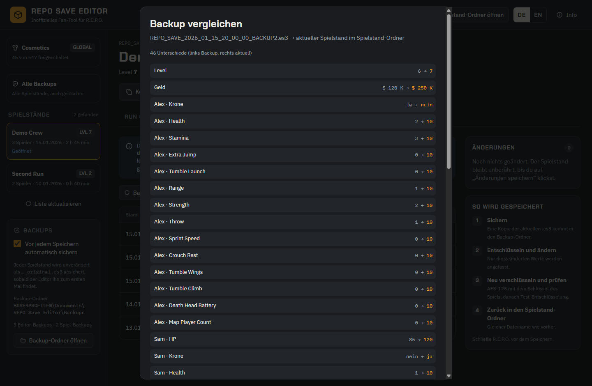
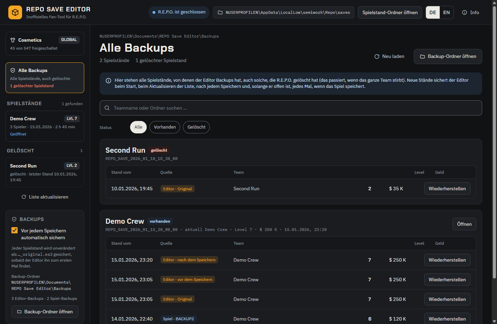

#  REPO Save Editor

Windows-App, um Spielstände von **R.E.P.O.** zu sichern, zu bearbeiten und wiederherzustellen: Run-Werte, Spieler-Upgrades, Waffen und Items im Truck sowie Cosmetics.

[English](README.md)

> **Inoffizielles Fan-Tool.** Nicht mit semiwork, dem Entwickler von R.E.P.O., verbunden, von semiwork weder unterstützt noch freigegeben. Nutzung auf eigene Gefahr. Der Editor sichert jeden Spielstand vor dem Speichern, aber Spiel-Updates können das Format ändern. Bearbeite nur deine eigenen Spielstände.



## Funktionen

| Bereich | Was du tun kannst |
|---|---|
| Run & Team | Teamname, Level, Geld, Leben, Ladestation, Gesamtbeute, Kaufzähler für Upgrade-Preise zurücksetzen |
| Spieler | Alle 13 Upgrades pro Spieler (Health, Stamina, Extra Jump, Tumble Launch, Range, Strength, Throw, Sprint Speed, Crouch Rest, Tumble Wings, Tumble Climb, Death Head Battery, Map Player Count), aktuelle HP, Krone |
| Waffen & Items | Alle 59 Items des Spiels in den Truck legen oder entfernen, Akkus aufladen |
| Profile | Mitgelieferte Schnellprofile und eigene, auf jeden Spielstand anwendbar |
| Backups | Alle Backups aller Spielstände in einer Liste, mit Teamname, Level und Geld; mit einem Klick wiederherstellen, auch Spielstände, die das Spiel gelöscht hat; jedes Backup mit dem aktuellen Stand vergleichen |
| Experte | Den kompletten Spielstand als JSON bearbeiten |
| Sprache | Deutsch oder Englisch, Umschalter **DE \| EN** oben rechts; die Wahl bleibt gespeichert (ohne Wahl gilt die Windows-Sprache) |
| Cosmetics (global) | Einzelne, gefilterte oder alle 547 Cosmetics freischalten; filtern nach Kategorie, Typ, Seltenheit (Common bis Ultra Rare) und Status; Cosmetics mit fester Farbe sind markiert |

Außerdem: **Kopie anlegen** erzeugt aus einem Spielstand einen neuen Slot, z. B. zum gefahrlosen Ausprobieren. Jede Änderung steht mit „vorher → nachher“ in einer Liste und lässt sich einzeln zurücknehmen, bevor etwas gespeichert wird.

| | |
|---|---|
|  |  |
|  |  |

Die Bilder zeigen erfundene Testdaten.

## Installieren

1. `REPO-Save-Editor-Setup-<Version>.exe` unter [Releases](https://github.com/Firetoox/REPO-Save-Editor/releases) herunterladen und ausführen.
2. Der Installer ist nicht signiert. Windows zeigt deshalb eventuell „Der Computer wurde durch Windows geschützt“: **Weitere Informationen → Trotzdem ausführen**.
3. Der Installer erscheint je nach Windows-Sprache auf Deutsch oder Englisch. Standardmäßig wird nur für deinen Benutzer installiert (ohne Administratorrechte) nach `%LOCALAPPDATA%\Programs\REPO Save Editor`; die Installation für alle Benutzer ist wählbar. Verknüpfungen kommen auf den Desktop und ins Startmenü.

Deinstallieren: Windows-Einstellungen → Apps. Deine Backups und Profile bleiben erhalten.

## Benutzen

1. R.E.P.O. schließen (solange das Spiel läuft, ist Speichern gesperrt).
2. „REPO Save Editor“ starten, links einen Spielstand wählen, Werte ändern.
3. Rechts die Liste der Änderungen prüfen, einzelne Änderungen bei Bedarf zurücknehmen.
4. „Änderungen speichern“ sichert die aktuelle Datei und speichert dann den geänderten Spielstand.

Neue Items erscheinen beim Laden des nächsten Levels im Truck. Im Mehrspielermodus zählt nur der Spielstand des Hosts; Mitspieler werden über ihre Steam-ID zugeordnet. Cosmetics gelten für alle Spielstände auf deinem PC, nicht pro Spielstand.

### Wenn das Spiel einen Spielstand löscht

R.E.P.O. löscht einen Spielstand, wenn das ganze Team stirbt. Die Backups des Editors bleiben: Gelöschte Spielstände erscheinen links unter **Gelöscht**, und **Alle Backups** listet jedes Backup jedes Spielstands mit Teamname, Level und Geld. **Wiederherstellen** legt den gelöschten Spielstand neu an, und er erscheint wieder im Spiel.

Der Editor sichert jeden neuen Stand eines Spielstands beim Start, beim Aktualisieren der Liste, nach dem Speichern und, solange er offen ist, jedes Mal, wenn das Spiel speichert. Lass ihn beim Spielen offen, dann ist jedes erreichte Level gesichert.



## Sicherheit und Datenschutz

- Sobald der Editor einen Spielstand zum ersten Mal sieht, sichert er ihn (und `MetaSave.es3`) unverändert als `…_original.es3`.
- Vor jedem Speichern wird der aktuelle Stand erneut gesichert, direkt danach auch der gespeicherte (außer du schaltest „Vor jedem Speichern automatisch sichern“ aus). Vor dem Wiederherstellen wird immer gesichert.
- Neue Stände des Spiels werden beim Start, beim Aktualisieren und, solange der Editor offen ist, sobald das Spiel speichert, gesichert (jeder Stand nur einmal). Einen Spielstand, den das Spiel löscht, stellst du aus diesen Backups wieder her.
- Gespeichert wird nur, wenn R.E.P.O. geschlossen ist und das Spiel die Datei seit dem Laden nicht verändert hat.
- Nach dem Verschlüsseln wird die Datei testweise wieder entschlüsselt; erst dann wird sie in einem Schritt gespeichert (keine halb geschriebenen Dateien).
- Nur geänderte Werte werden angefasst; die eigenen `BACKUP`-Dateien des Spiels bleiben unverändert.
- Der Editor sendet nichts ins Internet: keine Telemetrie, keine Update-Prüfung, keine externen Inhalte. Sein lokaler Server lauscht nur auf `127.0.0.1` an einem zufälligen Port und antwortet nur dem eigenen Fenster (Sitzungs-Token, strenge Content-Security-Policy).
- Backups enthalten dieselben Daten wie deine Spielstände (Steam-IDs und Namen aller Mitspieler). Wird dein Dokumente-Ordner mit OneDrive synchronisiert, gilt das auch für die Backups; mit `backupDir` (unten) legst du sie woanders ab.

## Wo liegt was

| Was | Ort |
|---|---|
| Spielstände (vom Spiel) | `%USERPROFILE%\AppData\LocalLow\semiwork\Repo\saves` |
| Cosmetics (vom Spiel) | `%USERPROFILE%\AppData\LocalLow\semiwork\Repo\MetaSave.es3` |
| Backups des Editors | `Documents\REPO Save Editor\Backups` (im Explorer „Dokumente“; Cosmetics unter `Backups\MetaSave`) |
| Profile, Einstellungen (Sprache, automatisches Backup), Fenstergröße, Log, Listen-Cache | `%APPDATA%\REPO Save Editor` |
| Spieldateien (nur gelesen) | über Steam gefunden (`libraryfolders.vdf`) |

Optional kann `%APPDATA%\REPO Save Editor\config.json` die Ordner überschreiben (danach den Editor neu starten):

```json
{
  "savesDir": "D:\\anderer\\Ordner\\saves",
  "metaFile": "D:\\anderer\\Ordner\\MetaSave.es3",
  "backupDir": "D:\\Backups\\REPO",
  "gameDir": "D:\\SteamLibrary\\steamapps\\common\\REPO"
}
```

## Stand

- Zuletzt geprüft mit Steam-Build `23363152` von R.E.P.O. Nach einem Spiel-Update zeigt der Info-Dialog einen Hinweis, und Item- und Cosmetic-Liste werden automatisch neu aus den Spieldateien gelesen. Ändert sich das Spielstand-Format selbst, verweigert der Editor das Lesen, statt etwas kaputt zu machen.
- Im Spiel mit diesem Build getestet: Bearbeitete Spielstände lassen sich laden, und alle Run-Werte, alle Spieler-Upgrades (samt aktueller HP und „Voll heilen“), alle Waffen und Items im Truck sowie alle 547 Cosmetics funktionieren.
- Nur Windows. R.E.P.O. muss installiert sein: Das Passwort der Spielstände liest der Editor aus den Spieldateien. Ohne Spielordner kann er verschlüsselte Spielstände nicht öffnen (er zeigt dann einen Hinweis) und nutzt seine mitgelieferten Item- und Cosmetic-Listen.

## Technik

R.E.P.O. speichert mit Easy Save 3: AES-128-CBC, Schlüssel per PBKDF2-SHA1 (100 Runden, IV als Salt) aus einem im Spiel enthaltenen Passwort; der Inhalt ist JSON. Der Editor liefert dieses Passwort nicht mit: Beim Start liest er die Texte aus dem Programmcode des Spiels (`REPO_Data\Managed\Assembly-CSharp.dll`) und nimmt den, der deine Spielstände öffnet. Auch Item-Namen, Cosmetics, Seltenheiten und Limits liest er aus den installierten Spieldateien (`REPO_Data`). Spieldateien verändert er nie, und er enthält auch keine.

## Selbst bauen

Voraussetzung: Windows und Node.js 22.13 oder neuer.

```
npm ci
npm start            # App starten
npm test             # Unit-, Round-Trip- und API-Tests mit Test-Spielständen
npm run test:ui      # App unsichtbar mit Test-Spielständen steuern (öffnet kein Fenster)
npm run dist         # Installer nach dist\ bauen
```

`npm run fixtures -- <Ordner>` erzeugt Test-Spielstände mit erfundenen Spielern für Demos, `npm run screenshots` erneuert die Bilder oben. Tests nie auf den echten Spielstand-Ordner richten, nur auf Kopien. Mehr in [CONTRIBUTING.md](CONTRIBUTING.md) und [SECURITY.md](SECURITY.md).

## Lizenz

MIT, siehe [LICENSE](LICENSE). © 2026 Firetoox. Die mitgelieferten Schriften (Chakra Petch, IBM Plex) stehen unter der SIL Open Font License 1.1, siehe [THIRD-PARTY-NOTICES.md](THIRD-PARTY-NOTICES.md). R.E.P.O. sowie die Namen der Items und Cosmetics gehören semiwork; Rechteinhaber, die etwas entfernt haben möchten, eröffnen bitte ein Issue.
