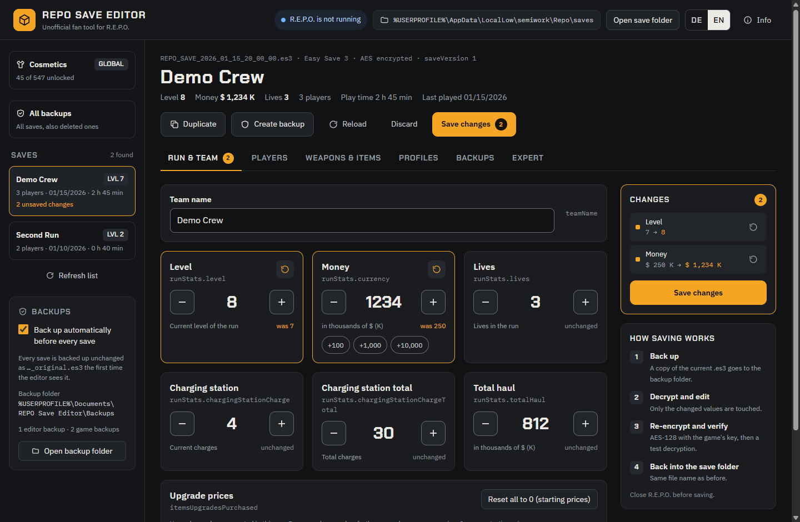
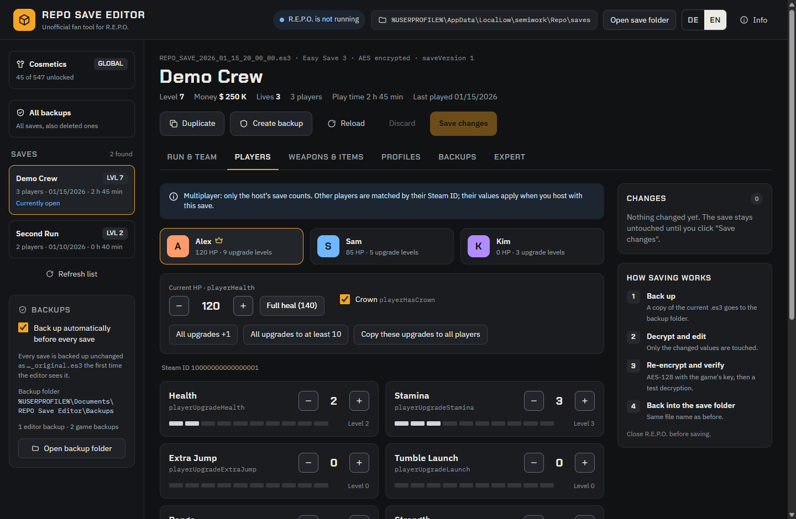
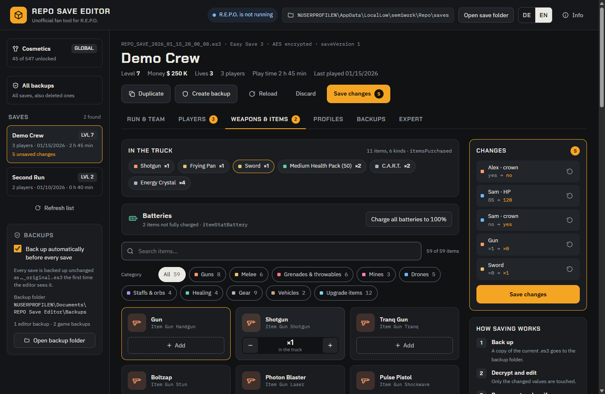
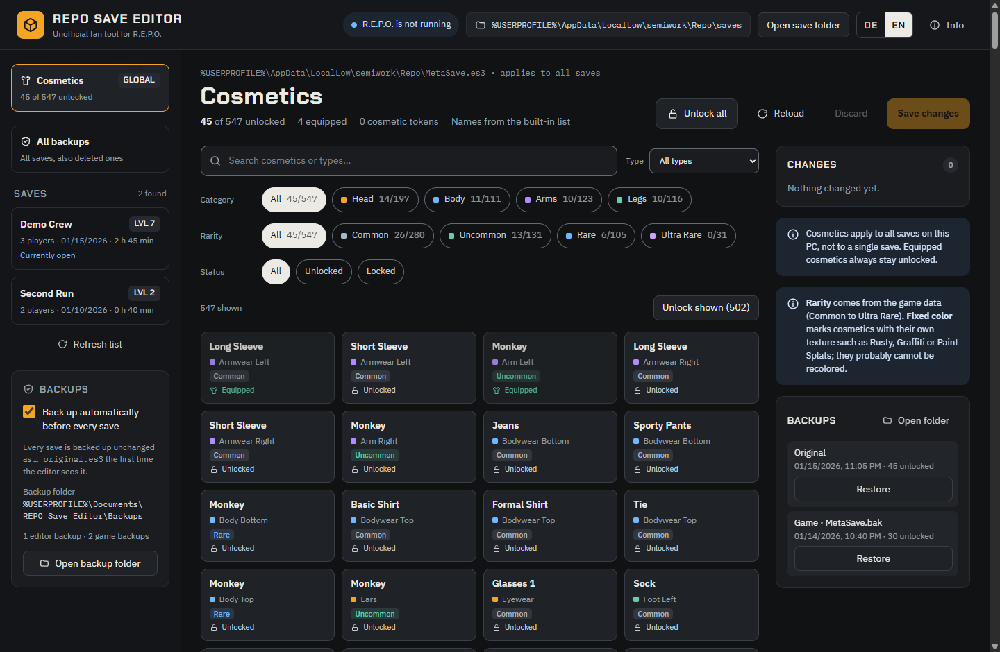
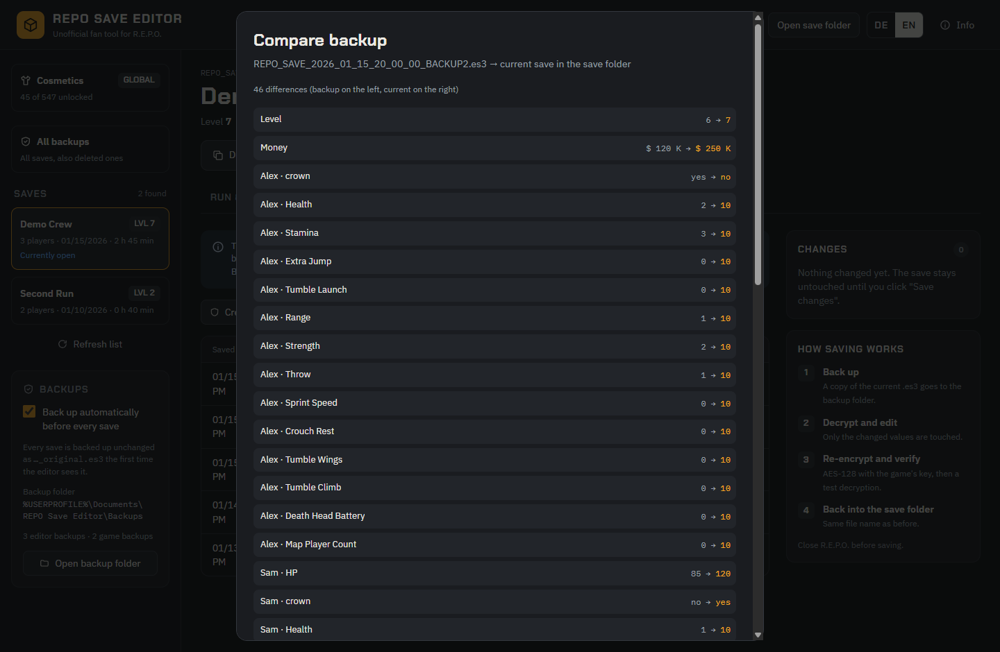
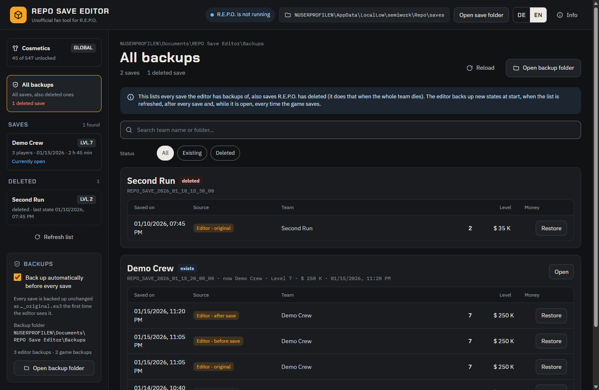

#  REPO Save Editor

Windows app to back up, edit and restore save games of **R.E.P.O.** – run values, player upgrades, weapons and items in the truck, and cosmetics.

[Deutsch](README.de.md)

> **Unofficial fan tool.** Not affiliated with, endorsed or supported by semiwork, the developer of R.E.P.O. Use at your own risk. The editor backs up every save before it saves changes, but game updates can change the save format. Only edit your own saves.



## Features

| Area | What you can do |
|---|---|
| Run & team | Team name, level, money, lives, charging station, total haul, reset the upgrade purchase counters that drive shop prices |
| Players | All 13 upgrades per player (Health, Stamina, Extra Jump, Tumble Launch, Range, Strength, Throw, Sprint Speed, Crouch Rest, Tumble Wings, Tumble Climb, Death Head Battery, Map Player Count), current HP, crown |
| Weapons & items | Put any of the game's 59 items into the truck or remove them, recharge batteries |
| Profiles | Built-in quick profiles and your own, applicable to any save |
| Backups | All backups of all saves in one list, with team name, level and money; restore with one click, also saves the game has deleted; compare any backup with the current save |
| Expert | Edit the complete save as JSON |
| Language | German or English, switch with **DE \| EN** at the top right; the choice is remembered (without a choice the Windows language is used) |
| Cosmetics (global) | Unlock single, filtered or all 547 cosmetics; filter by category, type, rarity (Common to Ultra Rare) and status; cosmetics with a fixed color are marked |

Also: **Duplicate** creates a new slot from a save, e.g. to try things safely. Every change is listed with "before → after" and can be undone individually before anything is saved.

| | |
|---|---|
|  |  |
|  |  |

The screenshots show invented test data.

## Install

1. Download `REPO-Save-Editor-Setup-<version>.exe` from the [Releases](https://github.com/Firetoox/REPO-Save-Editor/releases) page and run it.
2. The installer is not code-signed, so Windows SmartScreen may say "Windows protected your PC": click **More info → Run anyway**.
3. The installer shows German or English, depending on your Windows language. By default it installs for your user only (no admin rights) to `%LOCALAPPDATA%\Programs\REPO Save Editor`; installing for all users is offered as an option. It creates desktop and Start menu shortcuts.

Uninstall via Windows Settings → Apps. Your backups and profiles are kept.

## Use

1. Close R.E.P.O. (saving is blocked while the game is running).
2. Start "REPO Save Editor", pick a save on the left, change values.
3. Check the list of changes on the right; undo single changes if needed.
4. "Save changes" backs up the current file, then saves your changes.

New items appear in the truck when the next level loads. In multiplayer only the host's save counts; other players are matched by Steam ID. Cosmetics apply to all saves on your PC, not to a single save.

### When the game deletes a save

R.E.P.O. deletes a save when the whole team dies. The editor keeps its backups: deleted saves show up on the left under **Deleted**, and **All backups** lists every backup of every save with the team name, level and money. **Restore** creates the deleted save again, and it shows up in the game again.

The editor backs up every new state of a save when it starts, when you refresh the list, after saving and, while it is open, every time the game saves. Keep it open while you play, and every level reached is backed up.



## Safety and privacy

- The first time the editor sees a save (or `MetaSave.es3`), it copies it unchanged as `…_original.es3`.
- Before every save the current file is backed up again, and the saved state right after (unless you switch off "Back up automatically before every save"). Before a restore it is always backed up.
- New states the game writes are backed up at start, on refresh and, while the editor is open, as soon as the game saves (only once per state). A save the game deletes can be restored from these backups.
- Saving only happens when R.E.P.O. is closed and the game has not changed the file since it was loaded.
- After encrypting, the file is decrypted again as a check; only then is it saved, in one step (no half-written files).
- Only values you changed are touched; the game's own `BACKUP` files are never modified.
- The editor sends nothing to the internet: no telemetry, no update check, no external resources. Its local server listens on `127.0.0.1` on a random port and only answers its own window (session token, strict Content-Security-Policy).
- Backups contain the same data as your saves (Steam IDs and player names of everybody you played with). If your Documents folder is synced to OneDrive, they are synced too; set `backupDir` (below) if you do not want that.

## Where things are

| What | Location |
|---|---|
| Saves (created by the game) | `%USERPROFILE%\AppData\LocalLow\semiwork\Repo\saves` |
| Cosmetics (created by the game) | `%USERPROFILE%\AppData\LocalLow\semiwork\Repo\MetaSave.es3` |
| Editor backups | `Documents\REPO Save Editor\Backups` (cosmetics in `Backups\MetaSave`) |
| Profiles, settings (language, automatic backup), window size, log, list cache | `%APPDATA%\REPO Save Editor` |
| Game files (only read) | found through Steam (`libraryfolders.vdf`) |

Optional overrides in `%APPDATA%\REPO Save Editor\config.json` (restart the editor after changing it):

```json
{
  "savesDir": "D:\\other\\folder\\saves",
  "metaFile": "D:\\other\\folder\\MetaSave.es3",
  "backupDir": "D:\\Backups\\REPO",
  "gameDir": "D:\\SteamLibrary\\steamapps\\common\\REPO"
}
```

## Status

- Last checked against Steam build `23363152` of R.E.P.O. After a game update the info dialog shows a hint, and the item and cosmetic lists are re-read from the game files automatically. If the save format itself changes, the editor refuses to read a save instead of damaging it.
- Tested in game with this build: edited saves load, and every run value, every player upgrade (including current HP and "Full heal"), every weapon and item in the truck and all 547 cosmetics work.
- Windows only. R.E.P.O. must be installed: the editor reads the password of the saves from the game files. Without the game folder it cannot open encrypted saves (it then shows a hint) and uses its built-in item and cosmetic lists.

## How it works

R.E.P.O. stores saves with Easy Save 3: AES-128-CBC, the key derived with PBKDF2-SHA1 (100 iterations, the IV as salt) from a password contained in the game; inside is JSON. The editor does not ship that password: at start it reads the string literals of the game's code (`REPO_Data\Managed\Assembly-CSharp.dll`) and uses the one that opens your saves. Item names, cosmetics, rarities and limits are also read from the installed game files (`REPO_Data`). The editor never modifies game files and contains none.

## Build from source

Requires Windows and Node.js 22.13 or later.

```
npm ci
npm start            # run the app
npm test             # unit, round trip and API tests on synthetic saves
npm run test:ui      # drive the app offscreen on synthetic saves (no window opens)
npm run dist         # build the installer into dist\
```

`npm run fixtures -- <folder>` writes synthetic saves with invented players for demos, `npm run screenshots` regenerates the screenshots above. Never point tests at your real save folder; use copies. See [CONTRIBUTING.md](CONTRIBUTING.md) and [SECURITY.md](SECURITY.md).

## License

MIT, see [LICENSE](LICENSE). © 2026 Firetoox. Bundled fonts (Chakra Petch, IBM Plex) are licensed under the SIL Open Font License 1.1, see [THIRD-PARTY-NOTICES.md](THIRD-PARTY-NOTICES.md). R.E.P.O. and its item and cosmetic names belong to semiwork; if you are a rights holder and want something removed, please open an issue.
